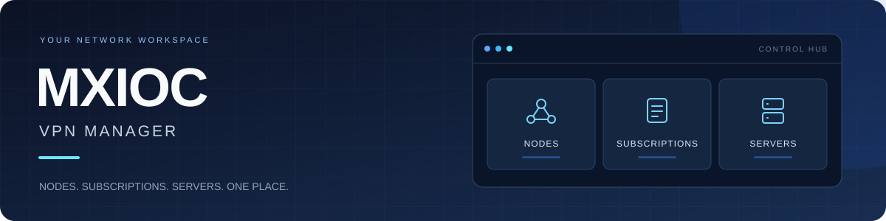
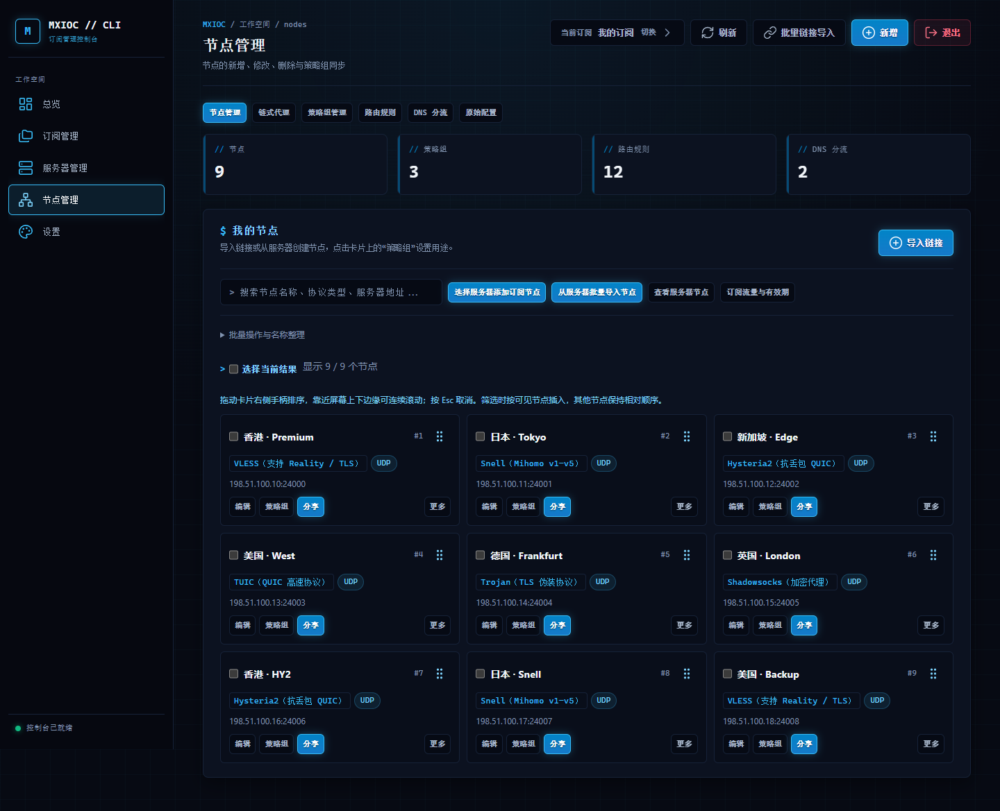
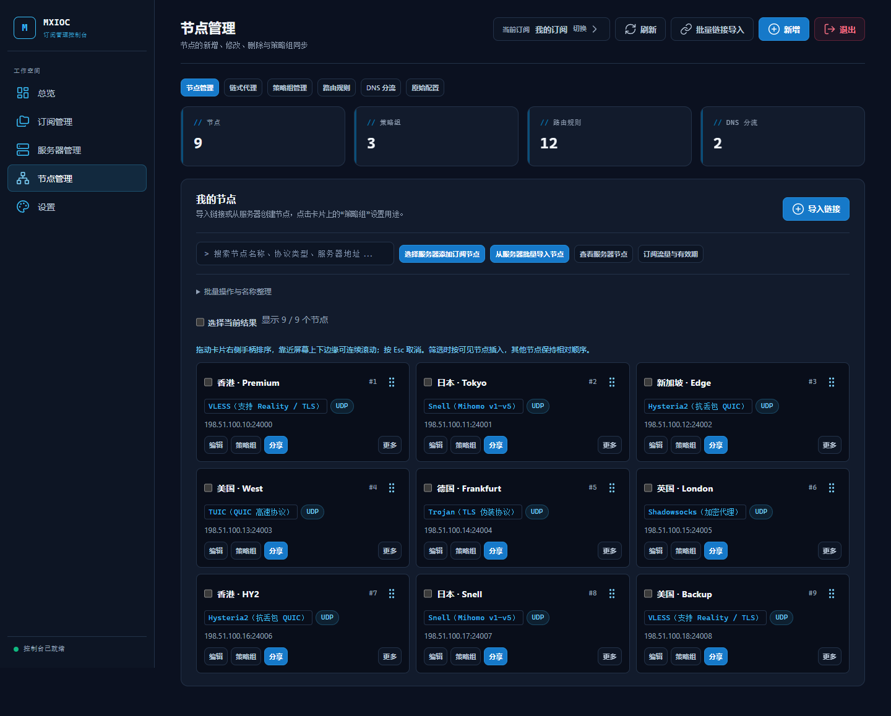
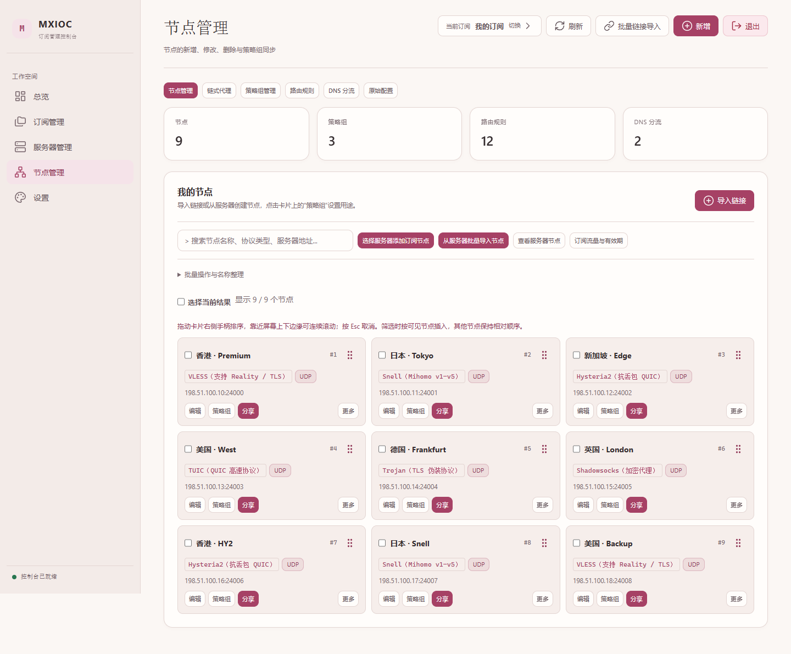

<p align="center">
  
</p>

<h1 align="center">MXIOC VPN Manager</h1>
<p align="center"><strong>你的节点，你的订阅，一个控制台。</strong></p>
<p align="center">面向 Mihomo / Clash 的可视化管理面板，让日常配置更直观。</p>

<p align="center">
  <a href="https://github.com/Angasky/mxioc-vpn-manager/stargazers"></a>
  <a href="https://github.com/Angasky/mxioc-vpn-manager/commits/main"></a>
  <a href="https://github.com/Angasky/mxioc-vpn-manager/issues"></a>
</p>

<p align="center">
  <a href="#界面一览">界面一览</a> &nbsp; / &nbsp;
  <a href="#功能地图">功能地图</a> &nbsp; / &nbsp;
  <a href="#快速部署">快速部署</a> &nbsp; / &nbsp;
  <a href="#使用文档">使用文档</a>
</p>

---

## 后端维护公告

旧版 **Python 后端不再更新新功能，仅维护和修复 BUG**。您可以继续使用当前版本，也可以在 **设置 → 后端版本** 中选择“一键迁移到 Go 后端”，迁移至 [Mx-Panel](https://github.com/Angasky/Mx-Panel)。

更新到本版后，登录会显示一次公告；阅读 5 秒后点击“我已知晓”，之后不再弹出。确认公告不会自动迁移。“继续使用 Python 后端”会保存您的选择，之后仍可随时在设置中发起迁移。

迁移条件、备份与恢复说明见 [Go 后端迁移指南](docs/go-migration.md)。

## 界面一览

**科技主题 · 把节点、策略和操作放在眼前**



<table>
  <tr>
    <td align="center" width="50%"><strong>简洁主题</strong><br><sub>减少装饰，专注管理</sub></td>
    <td align="center" width="50%"><strong>猛男主题</strong><br><sub>暖粉配色，柔和留白</sub></td>
  </tr>
  <tr>
    <td></td>
    <td></td>
  </tr>
</table>

<p align="center"><sub>截图来自当前界面，使用示例节点数据；三个主题可在设置中切换。</sub></p>

## 功能地图

| 模块 | 你可以做什么 |
| :--- | :--- |
| **节点管理** | 链接批量导入、拖拽排序、单节点策略组、二维码分享 |
| **订阅管理** | 多份订阅、套餐模板、流量额度、倍率与有效期 |
| **服务器管理** | 接入已有面板、创建节点、HY2 模板、单节点批量加入多份订阅、硬件监控 |
| **规则分流** | 策略组、路由规则、DNS 分流与链式代理 |
| **日常维护** | 网页更新、历史备份、配置校验、账号管理 |

### 协议与客户端

`VLESS` · `VMess` · `Trojan` · `Shadowsocks` · `HY2` · `TUIC` · `Snell` · `Mieru` · `SOCKS5` · `HTTP(S)`

**Mihomo / Clash** 完整订阅 &nbsp; · &nbsp; **V2Ray 系列** 节点订阅 &nbsp; · &nbsp; **Shadowrocket** 节点订阅

> [!NOTE]
> 协议能力随客户端和服务器内核而异。导出前可查看兼容提示，详见[客户端适配说明](docs/client-compatibility.md)。

## 快速部署

### 01 · 安装面板

在 Linux 服务器中执行：

```bash
curl -fsSL https://raw.githubusercontent.com/Angasky/mxioc-vpn-manager/main/install.sh | sudo bash
```

### 02 · 选择部署方式

按安装菜单选择 **域名 HTTPS**、**IP 部署** 或 **极速安装**，完成后访问脚本返回的管理地址。

### 03 · 开始使用

**新建订阅 → 导入链接 / 接入服务器 → 分配策略组 → 导入客户端**

> [!TIP]
> 下次维护只需输入 `vpn`，即可打开管理菜单、升级面板或重置管理员账号。

<details>
<summary><strong>展开部署前准备</strong></summary>

- 使用支持 systemd 的 Linux，准备 root 或 sudo 权限。
- 域名 HTTPS 模式先完成 DNS 解析；Cloudflare 域名使用「仅 DNS」，并放行证书验证所需端口。
- 创建 TLS / HY2 节点需准备远端证书与私钥，HY2 需放行对应 UDP 端口。
- 接入已有面板时填写现有账号，具体操作见[服务器节点工作流](docs/server-node-workflow.md)。

</details>

## 使用文档

| 开始配置 | 进阶使用 |
| :--- | :--- |
| [服务器与节点工作流](docs/server-node-workflow.md) | [流量倍率与节点限速](docs/traffic-multiplier-bandwidth.md) |
| [客户端兼容与导入](docs/client-compatibility.md) | [多入口主备与链路](docs/multi-entry-failover.md) |
| [Snell 节点说明](docs/snell.md) | [性能与测试说明](docs/performance.md) |
| [HY2 实际连通测试](docs/hy2-testing.md) | [版本更新日志](CHANGELOG.md) |

<details>
<summary><strong>开发验证与历史参考</strong></summary>

```bash
python -m unittest discover -s tests
```

真实内核测试的环境变量与运行方法见 [HY2 测试文档](docs/hy2-testing.md)。

[旧版完整说明](docs/legacy-reference.md)保留历史细节，部分内容对应旧版本，请结合更新日志阅读。

</details>

---

<p align="center">
  <strong>让复杂的配置，回到简单的操作。</strong><br><br>
  <a href="https://github.com/Angasky/mxioc-vpn-manager/issues">反馈问题</a> ·
  <a href="https://github.com/Angasky/mxioc-vpn-manager/issues/new">提出建议</a> ·
  <a href="CHANGELOG.md">查看更新</a>
</p>
